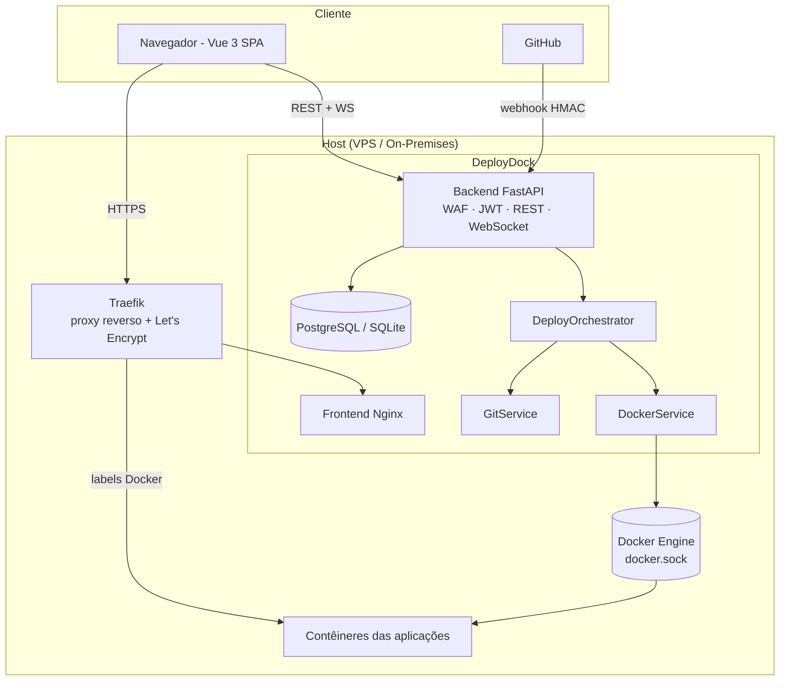
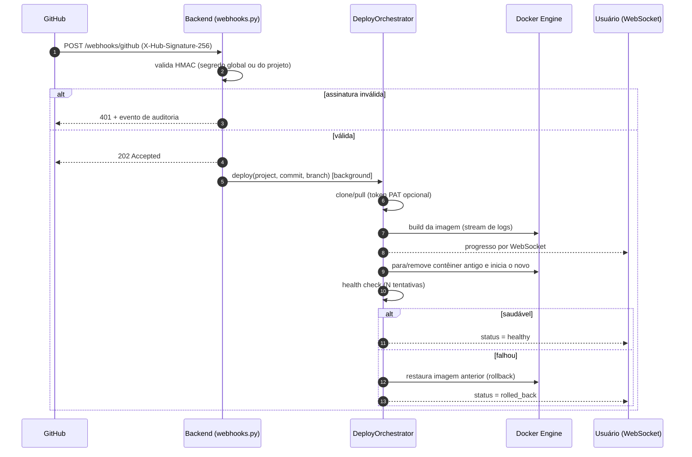
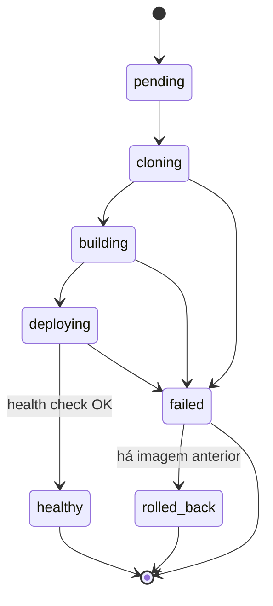
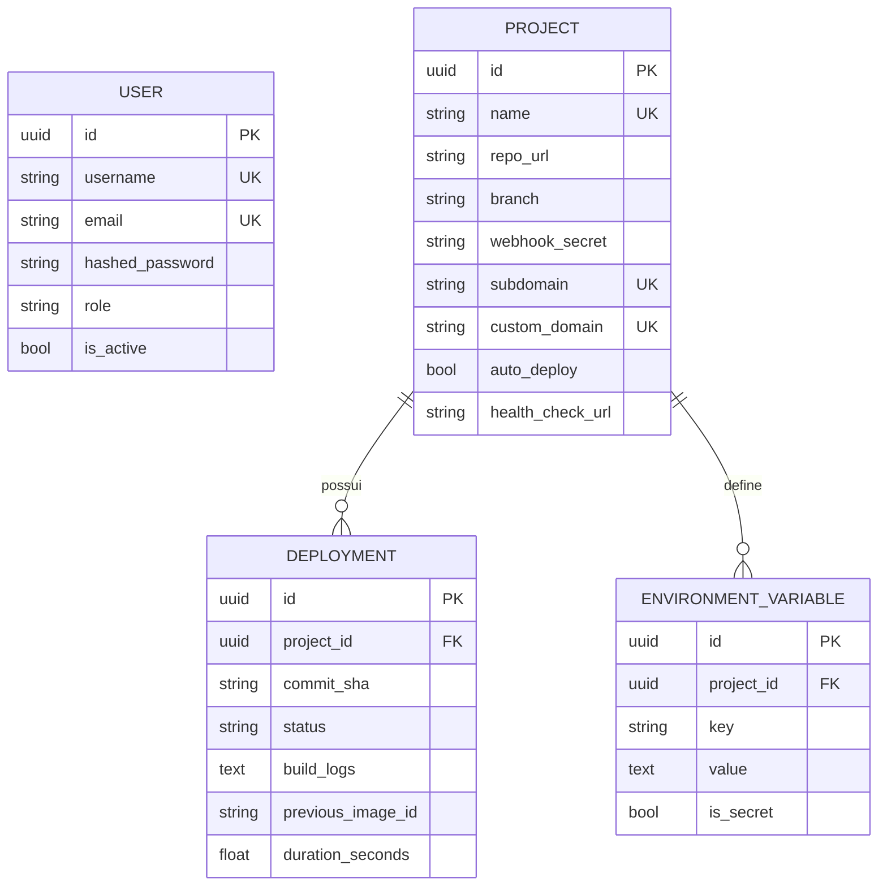
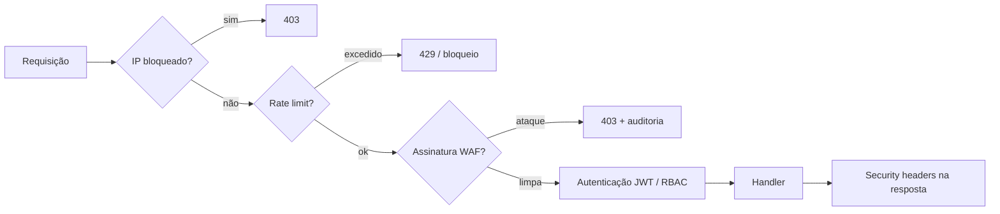

# Arquitetura

## 1. Visão geral



### Decisões de projeto

| Decisão | Justificativa | Consequência |
|---|---|---|
| FastAPI assíncrono + SQLAlchemy 2 async | I/O intensivo (Docker, Git, WebSocket) | Baixo consumo e concorrência simples |
| Webhook em vez de *polling* | Latência de deploy menor e sem tráfego ocioso | Exige endpoint público e segredo HMAC |
| Traefik com *labels* dinâmicas | Roteamento/HTTPS sem recarregar configuração | Dependência da rede `deploydock-apps` |
| Estado do WAF em memória | Simplicidade e latência mínima | Executar **1 worker** (ver `backend/Dockerfile`); estado perdido ao reiniciar |
| Docker SDK via `docker.sock` | Controle total sem agente adicional | Superfície de ataque elevada (ver `AMEACAS_E_LIMITACOES.md`) |
| SQLite como *fallback* de desenvolvimento | Subir sem Postgres | Produção deve usar PostgreSQL + `alembic upgrade head` |

## 2. Fluxo do webhook e deploy



## 3. Máquina de estados do deployment



## 4. Modelo de dados



## 5. Camadas do WAF / segurança ativa



## 6. Migrações

O esquema é versionado com Alembic (`backend/alembic/`).

```bash
cd backend
alembic upgrade head                       # banco novo
alembic stamp head                         # banco já criado pelo create_all legado
alembic revision --autogenerate -m "msg"   # nova migração após alterar modelos
alembic check                              # falha se modelos e migrações divergirem
```
