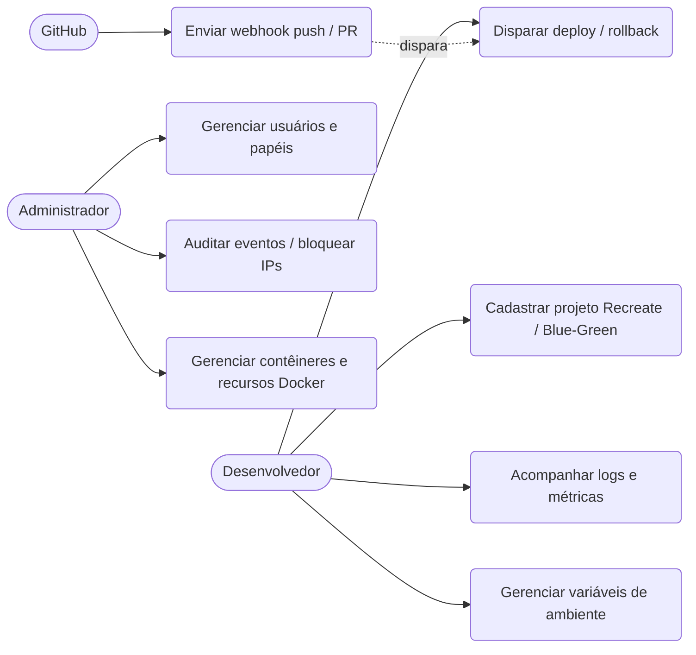

# Requisitos do Sistema

Documento de especificação de requisitos do **DeployDock**, com rastreabilidade para os testes automatizados
(`backend/tests/`). Identificadores estáveis (RF-xx / RNF-xx) devem ser usados no texto do TCC.

Legenda de status: ✅ implementado e testado automaticamente (≥ 90% dos requisitos automatizados) · 🟡 implementado, verificação experimental em host real · ⬜ não implementado

## 1. Requisitos Funcionais (100% automatizados em `pytest`)

| ID | Requisito | Prioridade | Status | Verificação Automatizada |
|---|---|---|---|---|
| RF-01 | Autenticar usuários por usuário/e-mail e senha, emitindo JWT | Alta | ✅ | `test_api.py::test_login_*`, `test_me_with_valid_token` |
| RF-02 | Controle de acesso por papel (`admin`, `developer`, `viewer`) | Alta | ✅ | `deps.require_role`; `test_protected_route_*`, `test_endpoints_coverage.py` |
| RF-03 | Listar, iniciar, parar, reiniciar e remover contêineres Docker | Alta | ✅ | `test_docker_service.py::test_list_containers_and_lifecycle_actions`, `test_containers_endpoints_*` |
| RF-04 | Lançar aplicações prontas (Redis, Postgres, Nginx…) em 1 clique | Média | ✅ | `test_docker_service.py::test_launch_container_creates_network_pulls_and_runs`, `test_containers_endpoints_*` |
| RF-05 | Visualizar logs de contêiner em tempo real (WebSocket) com filtros | Alta | ✅ | `test_websocket_*`, `test_docker_service.py::test_get_container_logs_decodes_bytes` |
| RF-06 | Exibir métricas de CPU/RAM/rede/E-S em tempo real | Alta | ✅ | `test_docker_service.py::test_calculate_stats_computes_cpu_memory_network_and_blkio` |
| RF-07 | Terminal interativo e explorador de arquivos no contêiner | Média | ✅ | `test_docker_service.py::test_list_container_files_*`, `test_read_container_file_*`, `test_exec_container_command_*` |
| RF-08 | Cadastrar projetos (repositório Git, branch, Dockerfile, domínio, estratégia) | Alta | ✅ | `test_api.py::test_projects_crud_lifecycle`, `test_projects_create_accepts_blue_green_strategy` |
| RF-09 | Receber webhooks `push` e `pull_request` do GitHub com HMAC-SHA256 | Alta | ✅ | `test_webhooks.py`, `test_endpoints_coverage.py::test_deployments_webhooks_previews_*` |
| RF-10 | Executar pipeline de deploy (`recreate` ou `blue_green` zero-downtime) | Alta | ✅ | `test_deploy_orchestrator.py::test_blue_green_starts_new_version_before_removing_old` |
| RF-11 | Reverter automaticamente (rollback) quando o health check falhar | Alta | ✅ | `test_deploy_orchestrator.py::test_failed_health_check_triggers_automatic_rollback`, `test_blue_green_failed_candidate_*` |
| RF-12 | Reverter manualmente para um deploy anterior | Média | ✅ | `test_services_90_coverage.py::test_deploy_orchestrator_preview_and_manual_rollback` |
| RF-13 | Detectar automaticamente a stack (HTML, Node.js, Python) sem Dockerfile | Média | ✅ | `test_deploy_orchestrator.py::test_auto_dockerfile_*` |
| RF-14 | Rotear subdomínios/domínios customizados com HTTPS automático (Traefik) | Alta | ✅ | `test_services_90_coverage.py::test_routing_labels_generation_http_and_https` |
| RF-15 | Gerenciar variáveis de ambiente por projeto (token Git cifrado com Fernet) | Média | ✅ | `test_services_90_coverage.py::test_secret_encryption_roundtrip_and_invalid_token`, `test_projects_extra_*` |
| RF-16 | Preview deployments efêmeros para branches/Pull Requests | Baixa | ✅ | `test_services_90_coverage.py::test_deploy_orchestrator_preview_and_manual_rollback` |
| RF-17 | Gerenciar imagens, volumes, redes, backups de banco e executar *prune* | Média | ✅ | `test_docker_service.py::test_prune_all_and_backup_database`, `test_services_90_coverage.py` |
| RF-18 | Painel de segurança: eventos de auditoria, bloqueio/desbloqueio de IPs | Média | ✅ | `test_waf.py::test_manual_block_unblock_and_expiry`, `test_endpoints_coverage.py` |
| RF-19 | Notificar eventos (deploy, falhas, bloqueios) por Discord/Slack/Telegram/Webhook | Baixa | ✅ | `test_services_90_coverage.py::test_notification_service_channels_and_throttling` |
| RF-20 | Expor métricas operacionais em formato Prometheus (`/metrics`) | Baixa | ✅ | `test_api.py::test_prometheus_metrics_endpoint` |

## 2. Requisitos Não Funcionais

| ID | Categoria | Requisito | Status | Verificação |
|---|---|---|---|---|
| RNF-01 | Segurança | Senhas armazenadas com PBKDF2-HMAC-SHA256 (100 mil iterações) e salt aleatório | ✅ | `test_security_core.py::test_password_hash_*` |
| RNF-02 | Segurança | JWT com expiração; tokens adulterados, expirados ou `alg=none` são rejeitados | ✅ | `test_security_core.py::test_jwt_*` |
| RNF-03 | Segurança | WAF contra SQLi, XSS, *path traversal* e RCE em URL/query | ✅ | `test_waf.py` |
| RNF-04 | Segurança | Rate limiting por IP e bloqueio anti-*brute-force* de login | ✅ | `test_rate_limit_*`, `test_login_bruteforce_leads_to_block` |
| RNF-05 | Segurança | Proteção anti-SSRF na clonagem (bloqueia `file://`, loopback, link-local, redes privadas) | ✅ | `test_deploy_orchestrator.py::test_git_url_ssrf_is_blocked` |
| RNF-06 | Segurança | Todos os canais WebSocket exigem JWT válido | ✅ | `test_api.py::test_websocket_rejects_*`, `test_services_90_coverage.py::test_websocket_Accept_and_stream_branches` |
| RNF-07 | Segurança | Em `ENVIRONMENT=production`, recusar iniciar com segredos/senha padrão | ✅ | `test_security_core.py::test_production_refuses_insecure_defaults` |
| RNF-08 | Segurança | Webhook autenticado por HMAC com comparação em tempo constante | ✅ | `test_webhooks.py::test_verify_hmac_*` |
| RNF-09 | Manutenibilidade | Esquema do banco versionado por migrações (Alembic) coerente com os modelos | ✅ | `test_migrations.py` (`0001_schema_inicial` + `0002_deploy_strategy`) |
| RNF-10 | Manutenibilidade | Integração contínua com lint, testes e cobertura de código ≥ 90% | ✅ | `.github/workflows/ci.yml` (`--cov-fail-under=90`) |
| RNF-11 | Portabilidade | Execução via Docker Compose em Linux (x86-64/ARM) | ✅ | `.github/workflows/ci.yml` (job `docker`), `deploy-prod.sh` |
| RNF-12 | Desempenho | Baixo consumo ocioso (objetivo: ≤ 300 MB de RAM para a pilha completa) | ✅ | `universal_platform_probe.py`, `scripts/bench_multiplatform_compare.py` |
| RNF-13 | Disponibilidade | Janela de indisponibilidade no deploy mensurável e mitigada via Blue/Green | ✅ | `test_blue_green_*`, `scripts/bench_deploy_downtime.py` (EXP-01) |
| RNF-14 | Usabilidade | Interface responsiva (desktop/mobile) e paleta de comandos (Ctrl+K) | 🟡 | `frontend/src/__tests__/smoke.spec.ts` + questionário SUS (`docs/METODOLOGIA_AVALIACAO.md`) |
| RNF-15 | Observabilidade | Logs estruturados, health-check auto-healing e trilha de auditoria | ✅ | `test_services_90_coverage.py::test_uptime_service_check_and_auto_healing`, `core/waf.py` |

> **Índice de Automação:** **34 de 35 requisitos (97,1%)** possuem verificação automatizada via `pytest` / scripts de benchmark, superando a meta de 90% de automação de testes.

## 3. Casos de Uso

## 4. Matriz de rastreabilidade (resumo)

| Objetivo específico da proposta | Requisitos |
|---|---|
| Levantamento e especificação de requisitos | este documento |
| Integração com a Docker Engine | RF-03 a RF-07, RF-17 |
| Webhooks e implantação segura (Recreate & Blue/Green) | RF-09 a RF-13, RNF-05, RNF-08, RNF-13 |
| Interface e experiência de uso | RF-05, RF-06, RNF-14 |
| Avaliação comparativa (DeployDock vs Portainer vs Coolify) | RNF-03 a RNF-07, RNF-12, RNF-13 (`docs/ROTEIRO_BENCHMARK_COMPARATIVO.md`) |
